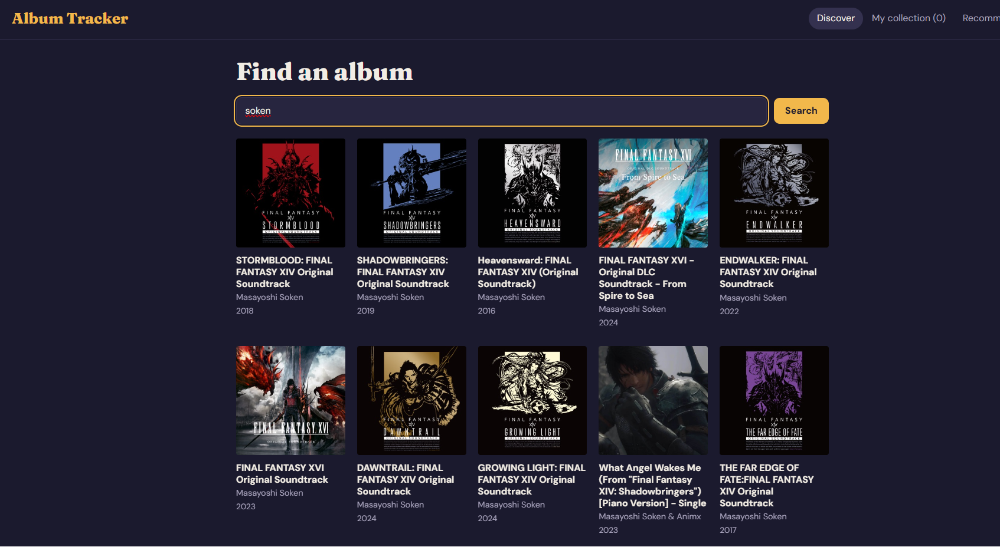
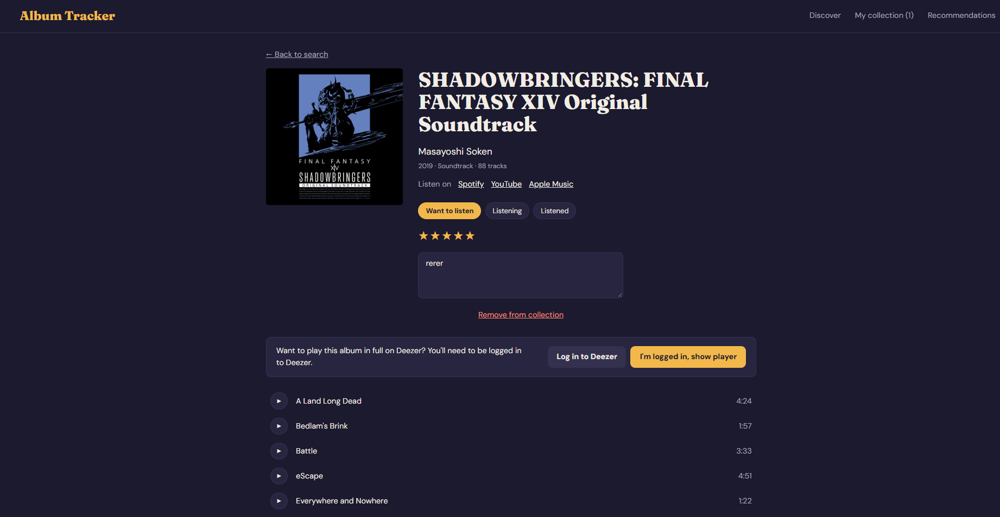
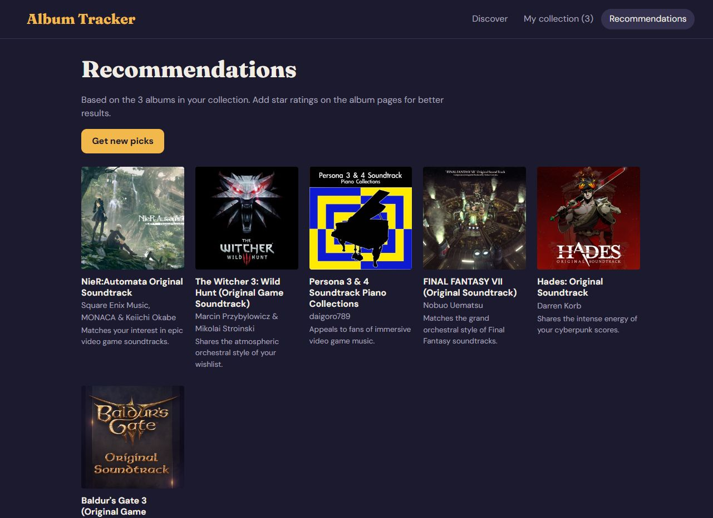

# Album Tracker

Album Tracker is a small React app for exploring music and keeping track of what you listen to.
Search for any album or artist, preview its tracks, and save it to your own collection with a
listening status, a star rating and notes. If Deezer has the album you can play it in full, and
the Recommendations page uses Google Gemini to suggest new albums based on the ones you already
saved and rated.

## Features

- Search for any album or artist using the iTunes Search API.
- Browse an album's cover, release details and track list, with 30-second previews.
- Save albums to your collection with a status (Want to listen, Listening, Listened), a 1–5
  star rating and notes.
- Filter and sort your collection by status, title, artist or rating.
- Play an album in full through Deezer when a match is available.
- Get AI recommendations from Gemini, based on the albums you have saved and rated.

## Tech Stack

- React with Vite
- Context API for state management
- iTunes Search API
- Deezer API
- Google Gemini API
- Vercel for deployment

## Running Locally

1. Clone the repository:

   ```bash
   git clone https://github.com/Tinapaa12/album-tracker.git
   cd album-tracker
   ```

2. Install dependencies:

   ```bash
   npm install
   ```

3. Create a `.env.local` file in the project root and add your Gemini API key:

   ```bash
   GEMINI_API_KEY=your_key_here
   ```

   Keep the name exactly as shown — a `VITE_` prefix would expose the key in the browser.

4. Start the dev server:

   ```bash
   npm run dev
   ```

## Limitations

- Track previews are limited to 30 seconds, which is all the iTunes API provides.
- Your collection is saved only in your browser's local storage, so it does not sync across
  devices and is lost if you clear your browser data.
- Deezer requires you to be logged in (and to be in a supported country or plan) before it will
  play full tracks instead of previews.

## Privacy Note

The recommendation feature sends information about your saved albums — titles, artists, ratings
and listening statuses — to Google's Gemini API so it can suggest similar music. Your personal
notes are never sent. Nothing is stored on a server and no account is required, but it is worth
knowing that this data leaves your browser when you request recommendations.

## Disclaimer

This project was built for educational purposes. It is not affiliated with, endorsed by or
sponsored by Apple, Spotify, Deezer or Google. All trademarks, music data and album artwork
belong to their respective owners.

## Screenshots

| Discover | Album page | Recommendations |
| --- | --- | --- |
|  |  |  |

https://album-tracker-murana.vercel.app/
